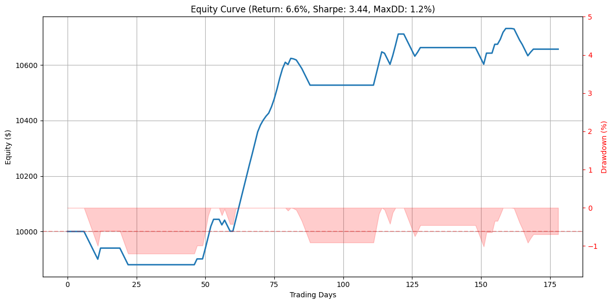

# A Transformer-Based Probabilistic Trading Strategy

A transformer classifier trained on AAPL daily bars. It scores the probability that the next close is higher. A trade is taken only when that probability clears a threshold and both RSI and the MACD difference agree. Exits are a +4% take-profit, a −2% stop, or the close five days later.

The source of the numbers below is [`A_Transformer_Based_Probabilistic_Trading_Strategy.ipynb`](A_Transformer_Based_Probabilistic_Trading_Strategy.ipynb). The write-up is published at [chrislernunes.github.io/Transformer-Based-Probabilistic-Trading](https://chrislernunes.github.io/Transformer-Based-Probabilistic-Trading/).

[`Transformer_with_Probabilistic_Output.ipynb`](Transformer_with_Probabilistic_Output.ipynb) is an earlier PLTR variant that uses only return and momentum. It is not the run reported here.
## This run

| | |
|---|---|
| Total return | 6.57% |
| Ending equity | $10,657 on $10,000 |
| CAGR | 9.43% |
| Sharpe ratio | 3.44 |
| Maximum drawdown | 1.20% |
| Win rate | 54.55% (42 of 77) |
| Decision threshold | 0.50 |
| Test signals | 179 |

Each entry is a fixed $1,000. No costs and no slippage. The chart title rounds the same run to a 6.6% return and a 1.2% drawdown.



## Method

- **Data.** AAPL daily OHLCV from Yahoo Finance, requested from 2023-01-01 through 2026-12-31. The download stops at the last session available when the notebook runs.
- **Features.** Log return, momentum (close minus its 5-day mean), RSI(14), MACD difference. Sequences of 20 days.
- **Label.** 1 if the next close is higher than the current close.
- **Model.** Linear map from 4 features to 32, then a `TransformerEncoder` of 2 layers and 4 heads (`batch_first=True`; feed-forward width and dropout stay at the PyTorch defaults, 2048 and 0.1). The sequence is flattened into a dense layer of 64 with ReLU, then a sigmoid.
- **Training.** Binary cross-entropy, Adam at learning rate 0.001, 20 epochs, batch size 32. The printed epoch loss is the sum of the per-batch means, not a per-sample loss. This run went from 16.3763 on epoch 1 to 15.8154 on epoch 20.
- **Split.** Last 20% of sequences, in time order (`train_test_split(..., test_size=0.2, shuffle=False)`). This execution has 179 test signals and 180 aligned closes.
- **Threshold.** The value in {0.50, 0.60, 0.70, 0.80} with the highest out-of-sample F1 on the up class. This run selected 0.50. That choice uses the test labels.
- **Entry.** Probability above the threshold, RSI of the last step above 50, and MACD difference of the last step above 0. The backtest buys the next close in its test-window price array.
- **Exit.** Over the next five sessions, a close at or beyond +4% books +4% of the $1,000, and a close at or beyond −2% books −2%. If neither prints and the position is still open, the actual close-to-close change at the fifth session is booked. Signals may overlap. Size does not compound.
- **Win.** A take-profit, or a time exit that finishes above the entry. A stop is a loss.
- **Metrics.** Total return, CAGR and Sharpe are computed on the cash path the notebook builds. PnL is added on the signal's loop step, so flat days stay flat. Sharpe is annualised with 252 and a zero risk-free rate. CAGR uses `(number of equity steps − 1) / 252`.

The notebook does not set a seed. A re-run will not reproduce this path exactly.

## Run

```bash
pip install -r requirements.txt
jupyter nbconvert --to notebook --execute A_Transformer_Based_Probabilistic_Trading_Strategy.ipynb
```

Research only. Not investment advice.
